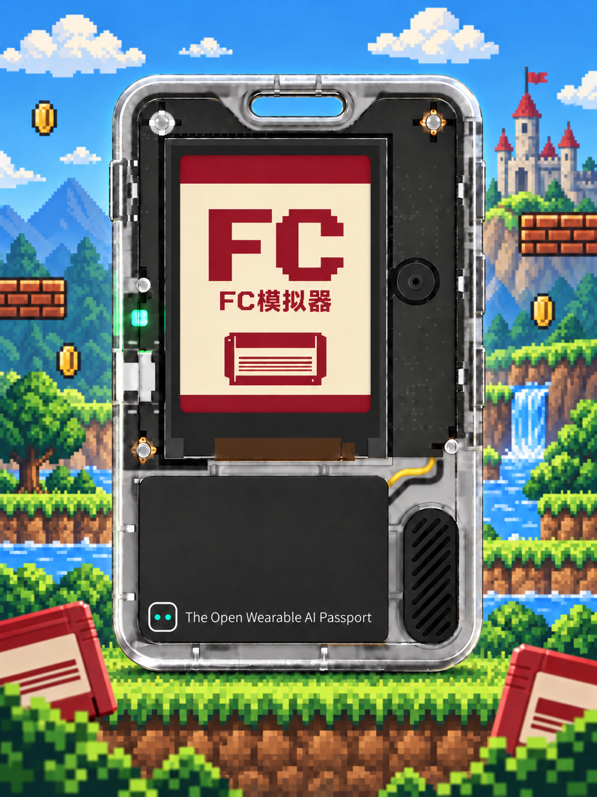

# FC模拟器 1.4

## 全页面 Select 返回（2026-10-12）

游戏管理热点名称为 `folotoy-fc`（无密码）。手机连接后，在浏览器输入 `http://192.168.4.1/`；提示无互联网时选择保持连接。设备屏幕显示完整 IP `192.168.4.1`，省去协议前缀以避免截断。本次源码修正尚未烧录到 COM14，之前交付的预装包仍使用旧热点名称。

所有原有长按 OK 返回/退出操作均支持长按 Select 1 秒，机身 OK 保留：设置（编辑时先结束编辑）、手柄测试、游戏管理、游戏列表/空列表、暂停菜单（保存成功后退出游戏）。配对取消/重试也复用该事件，但未连接或确认前没有可用手柄输入时仍需机身按键。进入页面及从子页面返回时重新建立持键基线，必须释放后再次长按，避免连续跨页退出。测试页 Select 短按用于观察，持续 1 秒返回。 FC 1.4 全页面 Select 返回版已写入 COM14，仅更新 0x10000 应用，保留 16 款游戏、存档和设置；写入哈希及启动身份校验通过。GameBoy 1.8 本批未烧录。全页面长按实际操作仍待用户反馈。




源码仓库：[PhoenixZHC/folotoy-fc](https://github.com/PhoenixZHC/folotoy-fc)。仓库包含源码、测试工具、文档及宣传图，**不包含商业游戏 ROM、预装游戏固件、存档或设备日志**。下文 `build/`、`deliverables/` 和 `.work/` 是本地生成路径，不是仓库下载链接。

ESP32-C3 / FoloToy AI Passport 的独立 FC/NES 固件，基于 GameBoy 框架并使用 Nofrendo 核心。**1.4** 增加 L1241 手柄支持、主页手柄导航和测试页、长按 Select 暂停，以及受限 NES 2.0 和擦写前上传校验；保留 1.3 启动/音频修复、Mapper 4 程序 ROM 1.5 MiB 上限、红白界面和彩色游戏。容量通过不代表全部 ROM 兼容。

完整预装 BIN、校验值和安装注意事项见 [1.4 交付说明](docs/release-1.4.md)。沿用原 16 款游戏，历史包保留；性能、存档和完整无线验收边界见验证记录。

当前变更与实测见 [1.4 记录](docs/release-1.4.md)，历史版本见 [中英文更新日志](CHANGELOG.md)。

当前 FC 24 组主机测试、正式构建与镜像校验通过。COM14 已安装包含 Select 暂停的 1.4 应用，保留 16 款游戏；写入及启动校验通过，长按操作待用户验收。此前 5 分钟游戏观察未见重启，但星之卡比有最长 155 ms 音频等待、3 次音频丢块和 2 个积压输入丢弃，原因未定位。历史启动修复见 [回归记录](docs/wifi-memory-regression.md)。

## 功能与边界

- 运行经典 NTSC iNES 和受限 NES 2.0 `.nes`，已接入 Mapper **0、1、2、3、4、7、23、66**。NES 2.0 支持范围内的普通／指数容量声明，接受 NTSC 或多区域、子型号 0、标准手柄配置。Mapper 4 程序 ROM 上限为 **1.5 MiB**，图形 ROM 上限 256 KiB；容量通过不代表所有变种兼容。拒绝 PAL、Dendy、FDS、异常长度和不支持的硬件声明，不修改用户 ROM。格式和诊断文件见 [NES 2.0 记录](docs/nes2-support.md)，历史容量实测见 [测试记录](docs/mapper4-capacity-test.md)。
- 按用户选择保留 240×320 竖屏，256×240 游戏画面等比缩放为 240×225，不裁切、不拉伸铺满；16 kHz 单声道 APU。LCD 后台传输期间只推进不改写帧缓冲的 CPU/APU 模拟帧；串口分别报告 emu_fps 与实际完成传输的 display_fps。
- 选中游戏且 ROM/存档校验成功后，播放约 1 秒 FC 卡带插入动画，再启动游戏；设备开机不播放。本轮启动回归包含动画和 LCD，用户已确认口袋妖怪运行正常；不代表全部游戏画面验收。
- 沿用 BLE 键盘/手柄输入、板载菜单按键、暂停、音量/亮度设置及 Wi-Fi 网页游戏管理。
- 源码新增良值 IINE L1241（固件 **27.02**）私有 BLE 适配，来源为 [GameBoy PR #1](https://github.com/PhoenixZHC/folotoy-gameboy/pull/1)，保留作者署名和 MIT 许可。请使用 PC 无线模式，进入配对状态后，在列表选择 `IINE GAMEPAD`；方向键／左摇杆、A/B、减号／加号对应方向、A/B、Select/Start。27.02 正常连接；同型号其他固件显示版本和“版本未验证”，按 OK 才尝试，长按 OK 取消，60 秒无确认则断开。确认仅对本次连接有效，其他型号仍拒绝。主页“游戏管理”下方新增“手柄测试”：显示双摇杆、方向、按键、扳机值和实时按下状态，长按机身 OK 返回；不发送震动、宏或校准命令。用户已在 FC 的 PC 无线模式确认 IINE GAMEPAD 连接及测试页按键正常；重连、其他固件和长期稳定性待验收，不能据此认定 Xbox 标准 HID 已验证。详见[适配记录](docs/l1241-support.md)。
- 键盘映射：WASD 移动、J=A、K=B、I=Select、L=Start；手柄使用十字键或左摇杆与 A/B；左摇杆采用 ±160 死区，同轴十字键优先。方向与攻击可同时保持。游戏输入缓存最多 16 次状态变化、最长 100 ms，逐模拟帧消费；暂停/断连清空，进入和恢复先松键。超限记录丢弃，不保证极密输入或长卡顿不漏按。1.1 包已包含修复；本轮手柄实测反馈正常，实体键盘和更多型号仍需专项验证。
- 最多 16 个游戏，共用约 4 MiB ROM 分区；每个名称最多 31 个 UTF-8 字节。ROM 直接映射 Flash，不依赖 PSRAM。8 KiB 电池 SRAM 双副本存档；没有即时存档功能。
- NES 2.0 明确区分无 PRG RAM、8 KiB 普通 RAM 和 8 KiB 电池 RAM；仅电池 RAM 保存。上传先读完整文件头，用与加载相同的规则检查，拒绝时显示具体原因且不擦写。热点固定为 `http://192.168.4.1/`，退出清理失败时保留句柄供重试；手机提示无互联网时需保持热点连接。
- 历史 16 款完整包已占满槽位，包含《武林外传》，游戏区剩余 4 KiB，独立保留 960 KiB 存档分区。清单及验证见 [16 款安装记录](docs/games-full16.md)。1.4 预装包沿用该分区；COM14 当前保留这 16 款游戏，最新状态见 1.4 记录。
- ESP32-C3 只有 BLE，不支持蓝牙经典协议手柄。已有游玩和输入变化日志；完整配对/断连重连、Wi-Fi 上传仍待专项验收，实际游戏速度见性能报告。
- 原框架 `gb_` 内部文件/接口名暂保留，编译使用的模拟核心是 `components/nofrendo`。旧启动动画文件不参与构建。

## 构建

环境：Windows PowerShell、ESP-IDF **5.5.3**、ESP32-C3、8 MiB Flash。本机 IDF 固定路径 `C:\esp\v5.5.3\esp-idf`。主机测试另需 PATH 中的 GCC。首次建立项目 Python 环境：

先克隆仓库并进入目录：

```powershell
git clone https://github.com/PhoenixZHC/folotoy-fc.git
Set-Location folotoy-fc
```

下面的 `tools/build.ps1` 使用开发机固定 IDF 路径。其他电脑先在自己的 ESP-IDF 5.5.3 PowerShell 环境中激活工具链，再执行 `idf.py set-target esp32c3`、`idf.py -B build -DFC_SIM_TEST=OFF build`，最后用项目 Python 执行 `tools/package_firmware.py`；无需本地商业 ROM 即可构建默认空游戏版本。第三方核心、BLE 和 BSP 源码随仓库保留，托管组件按 `dependencies.lock` 下载。

```powershell
py -m venv .venv
.\tools\build.ps1
& '.\.venv\Scripts\python.exe' tools/verify_firmware.py build
```

默认镜像在 `build/release/FoloToy-FC-full.bin`，8,388,608 字节，附同版本 ELF、MAP、sdkconfig 和 SHA256 清单。打包会验证 app 内嵌的 ELF SHA256、分区边界及写后回读。默认镜像**不含游戏 ROM**，含预格式化的空存档分区。

完整镜像从 Flash `0x0` 写入，会替换原固件及游戏/存档；1.0 已按用户授权烧录 COM14 并通过写入校验。不能把升级已有设备当作保留存档的增量更新。

## 放入自己的 ROM

启动后进入“游戏管理”，连接屏幕显示的 `FC模拟器` 热点，用页面上传 `.nes`；设备会验证 iNES／受限 NES 2.0 头、支持的 Mapper、文件长度和 SHA256。正式版本从“配对键盘或手柄”进入游戏列表，需要 BLE 输入设备。

也可生成本地专用的预装 ROM 镜像。名称较长时通过 `--name` 指定显示名称：

```powershell
& '.\.venv\Scripts\python.exe' tools/pack_roms.py --output build/local-roms.bin --name '魂斗罗' 'FC中文游戏全集\魂斗罗 [星空汉化].nes'
& '.\.venv\Scripts\python.exe' tools/pack_roms.py --verify build/local-roms.bin
& '.\.venv\Scripts\python.exe' tools/package_firmware.py --roms build/local-roms.bin --output build/local/FoloToy-FC-local.bin
```

这些命令只生成文件，不烧录。用户 ROM、临时产物及含 ROM 的镜像不属于默认分发内容。

## 自动化测试

```powershell
& '.\.venv\Scripts\python.exe' tools/test_host.py
& '.\.venv\Scripts\python.exe' tools/test_packaging.py
& '.\.venv\Scripts\python.exe' tools/test_roms.py 'FC中文游戏全集' --frames 1800 --draw-every 2
& '.\.venv\Scripts\python.exe' tools/rom_report.py
```

报告：`build/host-tests/results.json`、`build/rom-tests/results.json`、`build/rom-tests/report.html`。`ran` 仅表示指定帧数运行结束且末帧有多种颜色，不代表完整兼容或可通关；`blank_frame` 需要单独排查；`rejected` 是当前格式/Mapper 范围外，不会被强行加载。

## PassportSim

[模拟器网站](https://passportsim.bugs.cc/) / [源码](https://github.com/BlackHole1/passportsim)。本次使用官方 Windows v1.0.1 CLI，下载包校验通过。

该版本对本项目的 Bluepad32/BTstack 镜像报告 `unsupported image`，正式入口在蓝牙寄存器访问处触发 `E_TRIPWIRE`。因此建立**独立测试入口** `tests/fc_sim_main.c`，复用实际 FC、Flash、SPIFFS、LCD、I2S 和板载按键代码，跳过 BLE/Wi-Fi；生产入口不包含测试输入。

```powershell
.\tools\build.ps1 -Simulator
& '.\.venv\Scripts\python.exe' tools/test_simulator.py '.work/simulator/passportsim-1.0.1-windows-x64/passportsim.exe'
```

模拟器入口自动运行第一个 ROM，UP=A、DOWN=右、OK=Start，按一次发送一帧输入。这只是验收入口，不是完整手柄替代。自有诊断 ROM 镜像：`build-sim/release/FoloToy-FC-diagnostic.bin`；本地魂斗罗测试镜像：`build-sim/release/FoloToy-FC-Contra-local.bin`。画面底部显示 `SIM TEST`，不可与正式版本混淆。

模拟器报告在 `build/sim-tests/results.json`，保留原始返回值和未建模寄存器清单。v1.0.1 的 `run` 有返回 `result=pass`、`status=matched` 但进程退出 10 的情况；脚本明确记录该差异，只在 JSON 验收成功且没有 tripwire 时接受它。模拟器还记录 `st7789.sleep_cycle_too_fast.0x11`，本次未据此擅改参考 BSP 的屏幕时序，需结合真机确认。

当前结果和未验收项见 `CONTEXT.md`、`docs/release-1.4.md`，许可见 `THIRD_PARTY.md`。24 组主机测试通过；预装包、应用与 ELF 按记录中的哈希区分。普通构建关闭三个诊断开关，`-InputTrace` 用于输入诊断。源码使用不等于商业再分发授权。

显示性能优化采用 APU Q16 定点、CPU 指令跳转表、按实际绘制时机调度和跳帧精灵扫描精简；开源参考、前后对比方法与真机结果见 `docs/performance.md`。目标为实际显示超过 15 fps，不能以 emu_fps 或主机测试代替验收。
## 游戏暂停快捷键

游戏中长按手柄 Select 约 1 秒可打开暂停菜单，机身长按 OK 仍有效。短按 Select 保持游戏原功能，长按达到阈值前也正常传给游戏。进入或恢复游戏时已按住 Select，需要松开后重新长按，避免反复暂停。蓝牙键盘映射到 Select 的 I 键同样适用。
